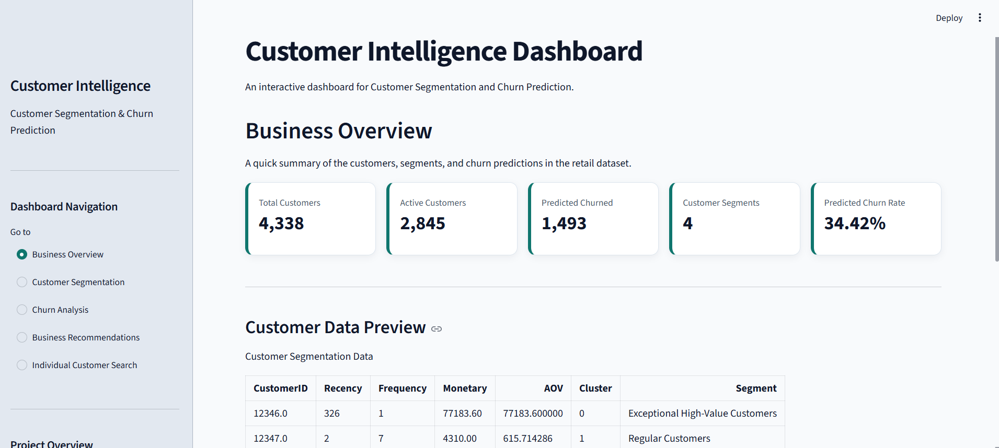

# Customer Intelligence: Customer Segmentation & Churn Prediction

## Project Overview

Customer Intelligence is a machine learning project that analyses retail customer purchasing behaviour to identify customer segments, predict churn risk, and generate actionable business recommendations.

The project uses the Online Retail dataset and combines customer segmentation, machine learning models, and an interactive Streamlit dashboard.

## 📊 Dashboard Preview

The project includes an interactive Streamlit dashboard that provides insights into customer segmentation, churn predictions, and business recommendations.

### Business Overview



The dashboard provides:
- Total customer and active customer metrics.
- Predicted churn count and churn rate.
- Customer segmentation overview.
- Customer data preview.
- Interactive customer analysis and business recommendations.

## Objectives

- Analyse customer purchasing behaviour.
- Segment customers based on their purchasing patterns.
- Identify potentially churned customers using a 90-day inactivity proxy.
- Train and compare Logistic Regression and Random Forest models.
- Generate customer-specific insights and retention recommendations.
- Present results through an interactive dashboard.

## Technologies Used

- Python
- Pandas and NumPy
- Matplotlib
- Scikit-learn
- Streamlit
- Joblib
- HTML and CSS

## Project Structure

```text
Retail-Customer-Churn-Intelligence/
│
├── dashboard/
│   ├── app.py
│   └── assets/
│       ├── metric_cards.css
│       └── layout_polish.css
│
├── data/
│   ├── raw/
│   └── processed/
│       ├── cleaned_retail_data.csv
│       ├── customer_features.csv
│       ├── customer_segments.csv
│       └── customer_churn_predictions.csv
│
├── models/
│   ├── logistic_regression.joblib
│   └── random_forest.joblib
│
├── src/
│   ├── eda/
│   ├── segmentation/
│   ├── churn_prediction/
│   ├── insights/
│   ├── data_loader.py
│   ├── data_cleaning.py
│   └── feature_engineering.py
│
├── .streamlit/
│   └── config.toml
│
└── README.md
```

## Project Workflow

### 1. Data Preprocessing
- Load and inspect the retail dataset.
- Clean the transaction data.
- Prepare customer-level information.

### 2. Feature Engineering
Customer-level features are created using:

- Recency: Days since the last purchase.
- Frequency: Number of purchases.
- Monetary: Total spending.
- AOV: Average Order Value.

### 3. Customer Segmentation
- Apply StandardScaler for feature scaling.
- Use the K-Means clustering algorithm.
- Identify four customer segments.

The resulting segments are:
1. Exceptional High-Value Customers
2. Regular Customers
3. Low-Engagement Customers
4. Highly Active High-Value Customers

### 4. Churn Prediction
- Define churn using a 90-day inactivity proxy.
- Train Logistic Regression and Random Forest models.
- Evaluate and compare model performance.
- Save trained models for future predictions.

### 5. Customer Insights
- Analyse predicted churn across customer segments.
- Identify potentially at-risk high-value customers.
- Generate business and customer retention recommendations.

### 6. Interactive Dashboard
Develop an interactive dashboard using Streamlit to present project results.

## Machine Learning Models

| Model | Accuracy |
|---|---:|
| Logistic Regression | 73.16% |
| Random Forest | 64.75% |

Logistic Regression performed better than Random Forest on the reported evaluation metrics.

## Dashboard Features

The dashboard contains five main sections:

1. **Business Overview:** Displays customer metrics and dataset previews.
2. **Customer Segmentation:** Shows segment distribution, churn analysis, customer filters, and CSV export.
3. **Churn Analysis:** Compares active and predicted churned customers across both models.
4. **Business Recommendations:** Provides retention strategies for each customer segment.
5. **Individual Customer Search:** Displays customer details, model predictions, risk assessment, and recommended business actions.

## Key Project Results

- Total customers analysed: 4,338
- Customer segments identified: 4
- Logistic Regression accuracy: 73.16%
- Random Forest accuracy: 64.75%
- Logistic Regression predicted churn rate: 34.42%

## How to Run the Project

### 1. Clone the repository

```bash
git clone YOUR_GITHUB_REPOSITORY_URL
```

### 2. Open the project directory

```bash
cd Retail-Customer-Churn-Intelligence
```

### 3. Create a virtual environment

```bash
python -m venv .venv
```

### 4. Activate the environment

Windows PowerShell:

```powershell
.venv\Scripts\Activate.ps1
```

### 5. Install dependencies

```bash
python -m pip install pandas numpy matplotlib scikit-learn streamlit joblib
```

### 6. Run the dashboard

```bash
python -m streamlit run dashboard/app.py
```

The dashboard will open in your browser.

## Important Note About Churn

Churn labels in this project are based on a 90-day inactivity rule using customer Recency. Therefore, churn predictions represent an inactivity-based proxy and should not be interpreted as independently confirmed future customer churn.

The model results are intended for analytical learning and business insight generation.

## Conclusion

This project demonstrates how machine learning can be used to analyse retail customer behaviour, identify meaningful customer segments, estimate churn risk, and support data-driven customer retention strategies through an interactive dashboard.


## Dataset & Attribution

This project uses the **Online Retail** dataset from the UCI Machine Learning Repository.

- **Dataset:** Online Retail
- **Creator:** Daqing Chen
- **Source:** [UCI Machine Learning Repository – Online Retail](https://archive.ics.uci.edu/dataset/352/online-retail)
- **DOI:** [10.24432/C5BW33](https://doi.org/10.24432/C5BW33)
- **License:** Creative Commons Attribution 4.0 International (CC BY 4.0)

**Dataset citation:**

Chen, D. (2015). *Online Retail* [Dataset]. UCI Machine Learning Repository. https://doi.org/10.24432/C5BW33

The dataset is used for educational and machine learning purposes. Appropriate attribution is provided to the original creator and repository.